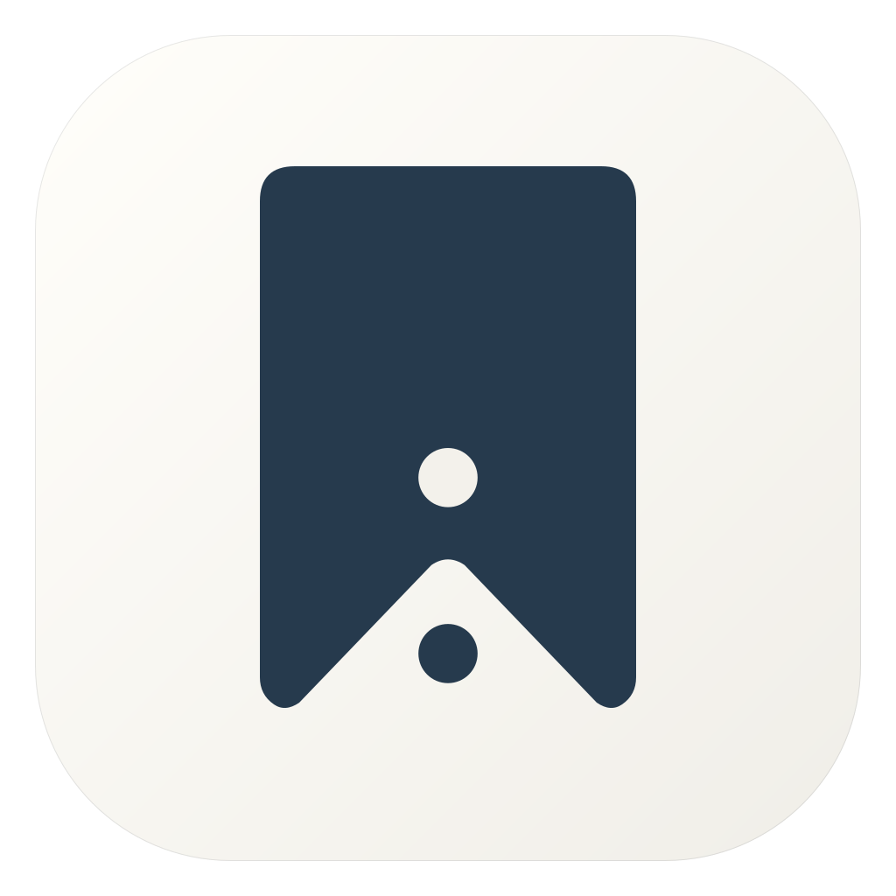
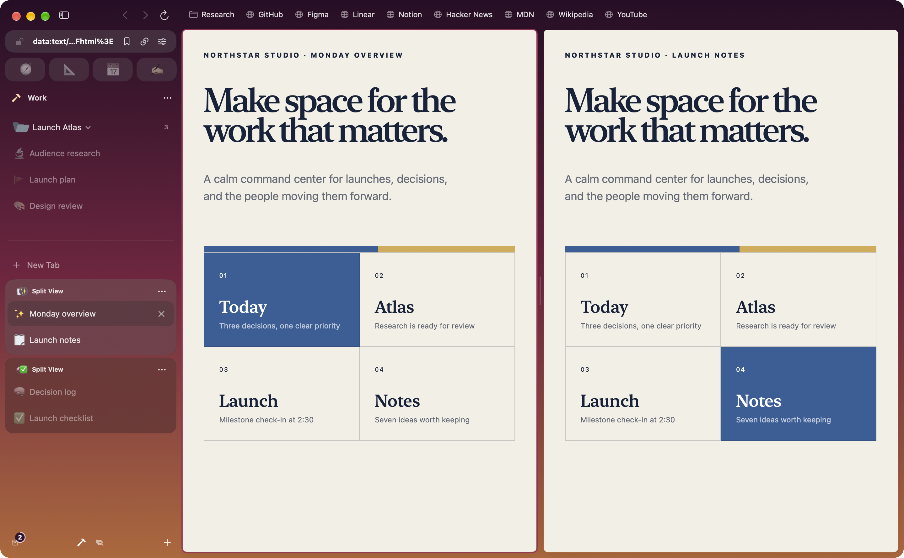
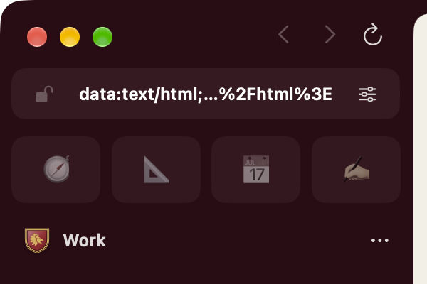
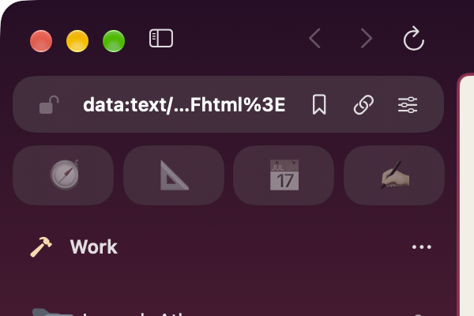
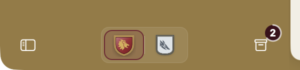
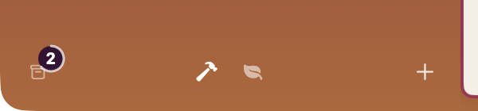
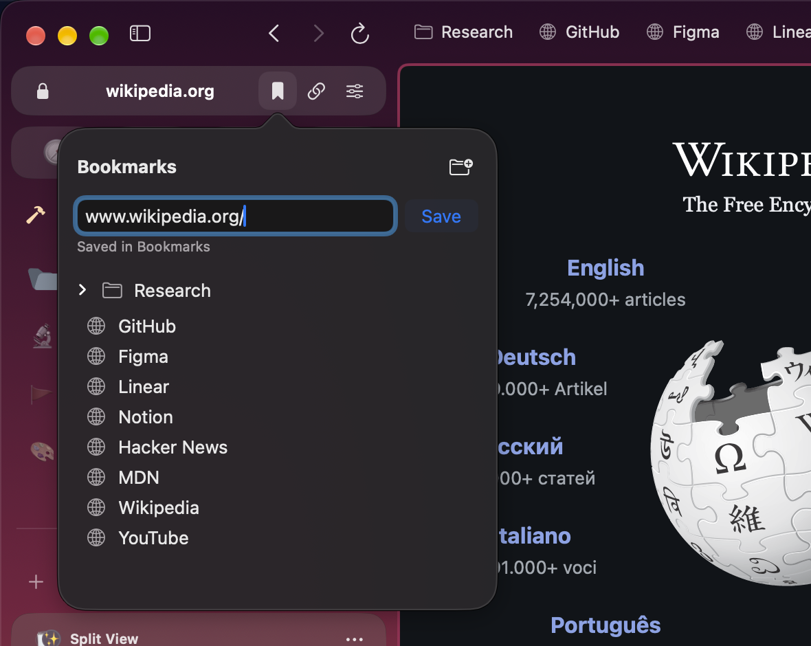
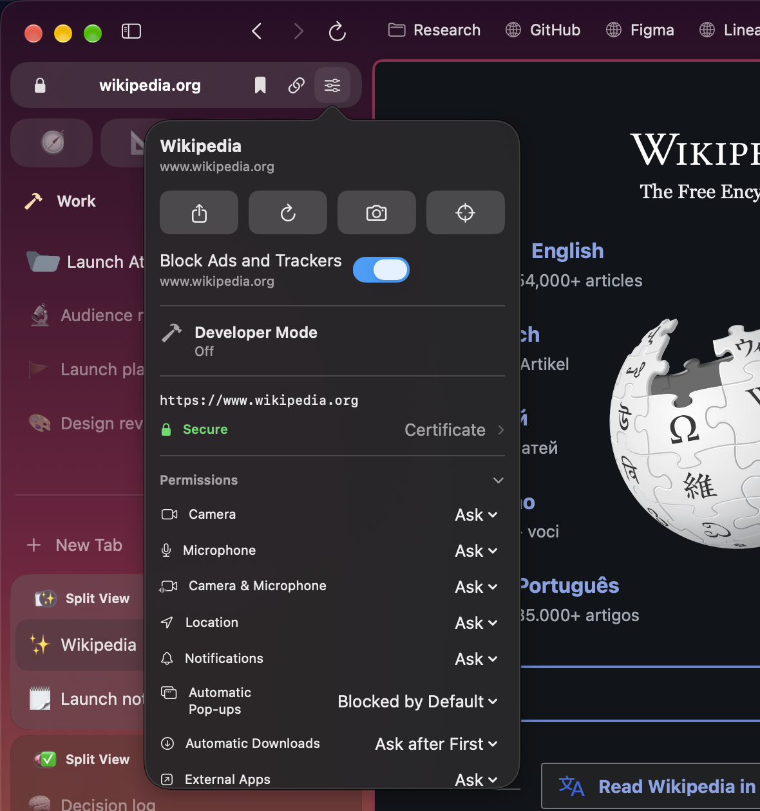
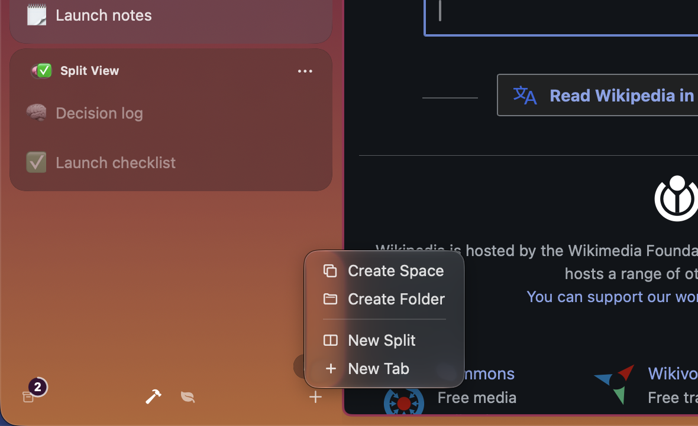

<div align="center">
  
  <h1>CrestArk</h1>
  <p><strong>A personal fork of <a href="https://github.com/pauljoda/Crest">Crest</a> by Paul Davis.</strong></p>
  <p>Crest with bookmarks, a few interface tweaks, and no banners or emblems (sorry, I don't like them).</p>
  <p>
    <a href="LICENSE"></a>
  </p>
</div>

<p align="center">
  <a href="Website/assets/crestark-work-mac.png"></a>
</p>

## What's different from Crest

CrestArk follows Crest's architecture and keeps its features. This is what it
adds and takes away. Downloads, App Store links, releases and sponsorship
further down this page belong to the original Crest.

### Side by side

The same sample Space in the original Crest and in CrestArk.

| Crest | CrestArk |
| --- | --- |
| <a href="Website/assets/crest-work-mac.png"></a> | <a href="Website/assets/crestark-work-mac.png"></a> |
|  |  |
|  |  |

### Added

- **Bookmarks.** Each Space keeps bookmarks in nested folders, and a bookmark
  or folder can show in every Space. The bookmarks button opens on the page
  you're viewing: save it as it is, type another address, or type
  `folder/address` to file it, creating the folder if needed. The same field
  searches your bookmarks. A bookmarks bar above the page holds what fits,
  puts the rest behind **+N**, and reorders by drag. The address field
  suggests bookmarks, and `@bookmarks` searches only them. Imports bring
  other browsers' bookmarks in as bookmarks.
- **Ad and tracker blocking from filter lists.** WebKit pages block with
  EasyList and EasyPrivacy (Balanced) or those plus uBlock Origin's lists
  (Strict), kept up to date. Chromium Spaces get uBlock Origin Lite when
  their blocking is on. Turn blocking off for one site from its site controls.
- **Arc imports, as they were.** Each Space's colors with their grain and
  intensity, its archived tabs, and its folders, pinned or not. A Space from
  Arc or another Chromium browser can also **stay signed in**: its cookies
  are decrypted in memory and set only in the Space they came from, matched
  to the right Arc profile, so each Space keeps its own accounts.
- **Undo for Clear Tabs.** Clearing a Space's open tabs asks first, and
  Command-Z brings them back.
- **An Arc-like sidebar.** A **+** menu at the bottom creates a Space,
  folder, split or tab, and the sidebar button sits beside the window
  controls. As the sidebar narrows, the address bar compacts and every Space
  but the current one becomes a dot that names itself on hover. Pinned
  sites resize to fill the row.
- **Calmer chrome.** Popovers are readable in light and dark and use your
  system accent. Hover highlights follow the pointer instantly. Extensions
  without a toolbar icon show their installed icon.

<p align="center">
  <a href="Website/assets/crestark-bookmarks-mac.png"></a>
  <a href="Website/assets/crestark-site-controls-mac.png"></a>
</p>
<p align="center">
  <a href="Website/assets/crestark-new-menu-mac.png"></a>
</p>

### Removed

- **Heraldic crests.** Spaces show their SF Symbol or emoji alone; the crest
  shapes, fields, bands, emblems, borders, finishes and their artwork are
  gone. A Space saved with a crest shows its plain icon.
- **Banner patterns and the setup look.** Every Space's sidebar is a
  gradient or a solid color, and setup goes from the welcome straight to
  import.
- **The fixed Balanced host list,** replaced by the filter lists above.
- **The page slide when switching Spaces.** The sidebar still slides.
- **Outlines and shadows on the selected tab and folders** by default.

## A browser with boundaries

Most browsers put every login, tab, and distraction into one long-lived container. Crest begins with **Spaces** instead. Give work, home, research, or a private session its own colors; Crest gives each one its own cookies, website data, history, archive, tabs, credentials, settings, and sync identity.

Switching Spaces changes more than the color of the window. It changes the browsing context.

## Two engines on Mac

Crest for Mac opens pages in **Chromium** by default. Its engine is built on
[ungoogled-chromium](https://github.com/ungoogled-software/ungoogled-chromium),
with Google integrations removed, and runs Chrome Web Store extensions. Any
website or page can open in **WebKit** instead, which adds Reader, whole-page
translation, built-in content blocking, and FairPlay video. When a page needs
protected video, Crest switches to WebKit automatically, respecting any
unsaved-changes prompt before moving it. Choose the default engine and
per-website rules in **Settings → Engines**. iPhone and iPad use WebKit. The
[engine guide](https://crestbrowser.com/guides/engines/) lists what each engine
supports.

## Crest Studio and Appearance

**Crest Studio** puts each Space's icon on that Space's own sidebar background. Start from a template, choose an emoji or a symbol from a searchable SF Symbols picker, and set the sidebar's gradient or solid color, each color named by what it paints. Shuffle and Undo freely.

**Appearance** lets you dock the sidebar on either edge, go borderless, adjust tab shape and scale, choose a pin layout, and tune tab and address-field colors, or let them follow each Space's accent. Start with a preset, see changes live, and reset individual settings. Choose an app icon palette, folder colors and icons, and a default page zoom from 50% to 300%.

## Browsing features

- **A sidebar with structure.** Pins for everyday sites, saved tabs with a home URL, nested folders for projects, and current tabs for what you are doing now. Select tabs, Split Views, and folders together to organize them in one step.
- **Split View.** Keep two to four live pages in a group. Resize columns on Mac and iPad; move through focused cards on iPhone.
- **Peek.** Preview a link above the current page, then close it or keep it as a tab. On Mac, drag a link into a live Peek. On iPhone and iPad, native link and image menus keep touch actions close by.
- **Quick Window on Mac.** Open a link from another app using the right Space’s signed-in session. Promote it to a regular tab when it deserves to stay. Link Routing sends matching external links to their chosen Space.
- **Shared windows on Mac.** Open another window onto the same Spaces and tabs, with its own selection. Use a disposable Blank Window for temporary tabs with your Space’s signed-in session, or create one by dragging a tab outside the window.
- **Search and commands.** Open a URL, search the web, find tabs and history in your Space, or run a command from one field. Choose custom search engines and optional suggestions. Mac shortcuts can be rebound.
- **Getting Started.** Learn tabs, pins, and folders in an interactive browser tab, with Split View practice on Mac.

## Page tools

| Capability | What it does |
| --- | --- |
| On-device translation | On iPhone, iPad, and WebKit pages, detect a page’s language, translate it, or show the original. On Chromium pages, translate selected text. Optional automatic translation uses downloaded languages. Apple may ask to download additional languages. |
| Reader and page tools | Read supported articles with fewer distractions on WebKit pages, find text, adjust zoom, share links, copy Markdown links, print, and export PDF or web archives where supported. |
| Extensions on Mac | Install Chrome Web Store extensions in each Space. They run on Chromium pages, with popups and tab-specific side panels. [Compatibility varies.](https://crestbrowser.com/guides/extension-compatibility/) |
| Developer tools on Mac | Preview phone, desktop, and custom viewport sizes; capture pages; open Chromium DevTools or Web Inspector for the page's engine. The toolbar appears on localhost, or on any site with **Shift-Command-I**. |
| Media | Control eligible active media from the sidebar. On Mac, keep supported videos visible with Picture in Picture, including optional automatic PiP. |
| Downloads and uploads | Follow download progress and revisit files in Downloads. Pause and resume Chromium transfers when the server supports recovery. On iPhone and iPad, upload through Photos, camera, or Files. |

## Privacy and sync

**Private Spaces** use temporary website storage and stay out of normal history, restoration, and sync. They can require device authentication and relock when Crest leaves the foreground. **Crest Passwords** keeps origin- and Space-matched credentials in the system Keychain, with authentication for sensitive access.

Site permissions and content blocking are controlled per Space. Built-in ad and tracker blocking covers iPhone, iPad, and WebKit pages with filter lists; Chromium Spaces block with uBlock Origin Lite. Closed and cleaned-up tabs go to a recoverable Archive, subject to your retention settings. **Keep Loaded** protects a page from ordinary unloading when its live state matters.

Optional **iCloud sync** carries durable Spaces, tabs, folders, Split View groups, appearance, history, and Archive between devices. Password values stay out of CloudKit; eligible passwords can use iCloud Keychain separately. Start a browser import on Mac, review each destination Space, or export a portable Crest archive.

Read the [privacy policy](https://crestbrowser.com/privacy/), [Space isolation guide](https://crestbrowser.com/guides/spaces-and-isolation/), and [sync guide](https://crestbrowser.com/guides/sync-across-devices/) for the boundaries and controls.

## Get Crest

The original Crest is available below; CrestArk has no published builds yet,
so build it from source as described under [Build Crest](#build-crest).

The same Spaces, shaped for each screen. iPad keeps the sidebar beside your page; iPhone gives your tabs and folders their own view.

| Platform | Install |
| --- | --- |
| Mac · Apple silicon · macOS 26.1+ | [Signed, notarized download](https://github.com/pauljoda/Crest/releases/latest) with built-in Sparkle updates.<br><br>Or install via Homebrew:<br>`brew install --cask crest-browser` |
| iPhone · iOS 26.1+ | [App Store](https://apps.apple.com/us/app/crest-browser/id6797335023) |
| iPad · iPadOS 26.1+ | [App Store](https://apps.apple.com/us/app/crest-browser/id6797335023) |
| iPhone & iPad beta | [TestFlight](https://testflight.apple.com/join/vV1CM49Q) |

## Built as an Apple-platform app

Crest's browser state and rules live in a portable core written in C# and compiled with NativeAOT. The apps are written in Swift and SwiftUI: shared features live in `CrestShared`, and each platform owns its windows, engine hosting, commands, and adaptive presentation. On Mac, pages render in Chromium by default or in WebKit; iPhone and iPad use WebKit.

```text
CrestCore/       Portable core: session, sync, pages, and browser rules
CrestContracts/  C ABI header and ABI checks for the core library
CrestEngines/    Chromium host overlay, patches, and engine binding
CrestShared/     Domain, application, infrastructure, features, design system
CrestMac/        macOS app and platform-specific presentation
CrestMobile/     iPhone and iPad app and platform-specific presentation
```

Read [the architecture overview](Documentation/ARCHITECTURE.md) for Space isolation, persistence, credentials, synchronization, and the engine boundary.

## Build Crest

Requirements:

- Apple silicon Mac
- Xcode with macOS and iOS SDKs supporting the 26.1 deployment targets
- [XcodeGen](https://github.com/yonaskolb/XcodeGen)
- .NET SDK pinned by `CrestCore/global.json`, installable with `Scripts/control-plane/install-dotnet.sh`

```bash
git clone https://github.com/Ladvace/Crest.git
cd Crest
Scripts/bootstrap.sh
open Crest.xcodeproj
```

Xcode builds and embeds the self-contained .NET core for Mac, iOS, and Simulator. Its intermediate files stay in Derived Data; the installed app does not require a .NET runtime. The `Crest` scheme builds the Mac app with WebKit only; releases add a prebuilt Chromium engine, described in the [Chromium engine README](CrestEngines/Chromium/README.md). See the [control-plane build workflow](Documentation/Architecture/ControlPlane.md#build-workflow) for isolated review builds and Chromium packaging.

`project.yml` is the source of truth for targets and build settings. Run `xcodegen generate` after changing source roots, targets, or project configuration.

## Releases and updates

The [Crest 0.8 release notes](CHANGELOG.md#080---2026-10-12) describe coding
agents on Mac, the new command palette and Settings, and more browsers to import
from. Crest requires Apple silicon and macOS 26.1 or later on Mac; iPhone and
iPad use WebKit.

When updating from a WebKit-only release, your Spaces, tabs, history, and Crest
Passwords carry over. Chromium has separate website storage, so sites may ask
you to sign in again. You can keep WebKit as your default. Reinstall older
WebKit extensions from the Chrome Web Store in each Space. The
[upgrade guide](https://crestbrowser.com/guides/engines/#after-updating-from-a-webkit-only-crest)
explains these changes and the engine feature limits.

macOS releases are distributed directly through GitHub Releases as signed,
notarized Apple-silicon disk images, one app with both engines. Crest uses
Sparkle 2 with a native SwiftUI update interface. Stable and nightly builds
share a signed appcast, and development builds have their own; choosing Nightly
or Development is an explicit choice in Settings → About.

GitHub Actions builds every public release, verifies its Developer ID signature
and notarization, publishes provenance and checksums, then updates the signed
`updates` branch appcast and that channel's release-note cursor together only
after the immutable release assets exist. Public downloads live in GitHub
Releases rather than GitHub Packages. See the [distribution
runbook](Documentation/Distribution.md) for the channel, credential,
publication, and verification contracts.

## Validate a change

```bash
Scripts/validate-identity.sh
Scripts/validate.sh
Scripts/validate-cache-hygiene.sh
```

Run the relevant behavioral tests and repository checks. Review visual, layout, and static-copy changes in the real app, Simulator, or browser.

## Project status

Crest is under active development. The current implementation includes the core browsing, Space isolation, native platform chrome, credentials, data portability, synchronization foundations, Quick Window, Peek, and privacy features described above. The [Crest Roadmap project](https://github.com/users/pauljoda/projects/3) is the public release view; approval-gated and physical-device work remains documented in the [roadmap](Documentation/ROADMAP.md).

## Community and support (original project)

Use [r/CrestBrowser](https://www.reddit.com/r/CrestBrowser) for questions,
feedback, ideas, and website or extension compatibility discussion. Use
[GitHub Issues](https://github.com/pauljoda/Crest/issues/new/choose) for
reproducible bugs and concrete tracked outcomes. Security concerns belong in a
[private vulnerability report](https://github.com/pauljoda/Crest/security/advisories/new),
never a public post. [SUPPORT.md](SUPPORT.md) explains each route in detail.

Crest is one of several open source projects built by Paul Davis. You can
support the work through [Ko-fi](https://ko-fi.com/pauljoda/tiers) or
[GitHub Sponsors](https://github.com/sponsors/pauljoda). Sponsorship does not
buy roadmap priority or private access.

## Sponsors - (Paul Davis, not me)

Monthly support helps pay for hosting, signing, testing, and development across
Paul's open source projects. Sponsors can be recognized in the public
[sponsor roll](SPONSORS.md) at one of three levels:

- **Sponsor — $25/month:** top placement with an optional approved link.
- **Sustainer — $10/month:** higher placement with an optional approved link.
- **Supporter — $3/month:** name in the public roll.

Recognition is optional. A listing is a thank-you, not an endorsement or a way
to buy roadmap priority, private support, or project ownership. See the
[membership tiers on Ko-fi](https://ko-fi.com/pauljoda/tiers) to become a
monthly sponsor.

## AI usage

AI tools assist with Crest's development, audits, testing, documentation, and
project maintenance. Maintainers direct product design and architecture, review
generated changes, and remain responsible for everything that ships.

Contributors are welcome to use AI tools. You must understand, review, and
validate what you submit, explain your decisions, and address feedback. The
same quality standards apply regardless of how a contribution was produced.

Any change an AI tool helped produce must follow the
[`crest-contribution` skill](.agents/skills/crest-contribution/SKILL.md). It
carries the C# and Swift style, the architecture and UI rules, the test
policy, and the pull request requirements that are not obvious from the code.
Claude Code finds it through `.claude/skills` and Codex through
`.agents/skills`; any other agent should start from [`AGENTS.md`](AGENTS.md),
which points to it. The pull request template asks you to confirm the skill
was followed, and a check reads that answer. Every pull request also receives
an automated CodeRabbit review; treat its comments as a first pass, not a
verdict.

Submit only work you can stand behind. AI-generated code, test results, and
claims need verification before they become part of a contribution.

## Contributing

Want to help? Please do! While I feel confident doing the actual dev work,
there are some areas that desperately need help.

- **Designer:** if you are a designer, I would love any input or help with the website, promotional material, and feedback on the app's UI itself.
- **Security:** I have some background in cyber security, mainly red team/blue team and some as a dev, so I welcome any and all security audits and improvements. Please report findings through the built-in security reporting.
- **Engine guru:** if you have lots of experience with Chromium and browser engines in general, I would love any input or help.

While those are the larger needed roles, anyone is free to contribute. Please
follow the guidelines and make sure your work is well done and aligns with the
product. If you have a more drastic change, you can always fork it to try it
out, then share it to see whether it would be a good fit to merge in.

See [CONTRIBUTING.md](CONTRIBUTING.md) for setup and change discipline,
[GOVERNANCE.md](GOVERNANCE.md) for project ownership, and the
[documentation index](Documentation/README.md) for engineering references.
Architecture changes should preserve the Space boundary and the native shape
of each platform.

## Contributors

<a href="https://github.com/pauljoda/Crest/graphs/contributors">
  
</a>

## License and brand

Crest source code is available under the [Mozilla Public License 2.0](LICENSE).
The source is open for inspection, modification, and commercial use under that
license. The Crest name, app icon, logos, and official distribution identity
are reserved; modified distributions must use their own branding as described
in [TRADEMARKS.md](TRADEMARKS.md). Third-party notices are collected in
[THIRD_PARTY_NOTICES.md](THIRD_PARTY_NOTICES.md).
